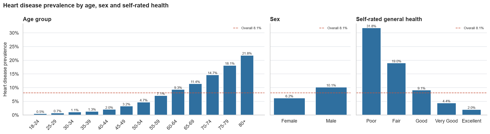
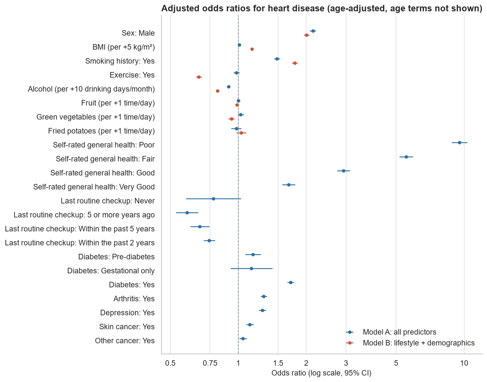
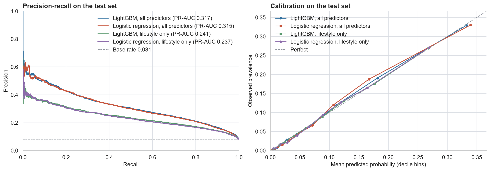
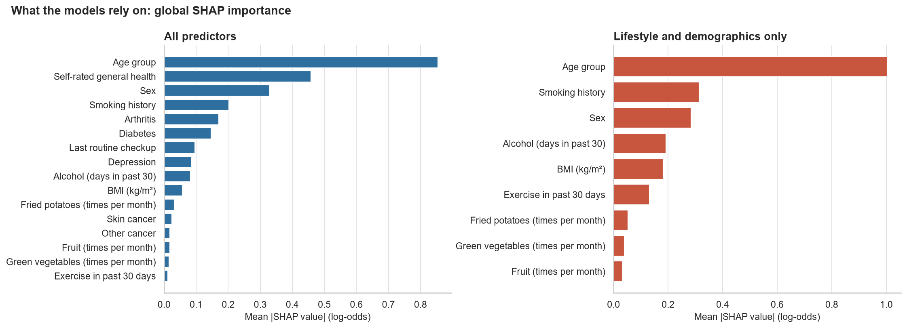
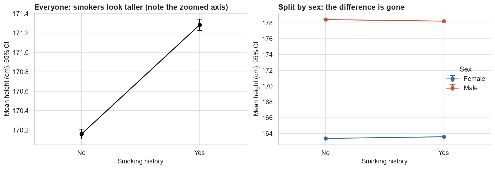

# Heart disease risk in BRFSS 2021: what is associated with it, and how well can it be predicted?

An end-to-end analysis of 308,774 US survey respondents: which lifestyle and health factors go with heart disease, which of those associations survive adjustment, and how far a model can predict it.

## Key findings

- **Age dominates.** 8.1% of respondents report heart disease, rising from 0.5% at ages 18-24 to 21.8% at 80+. Age and self-rated general health are the only strong associations (Cramér's V 0.24 and 0.25); diabetes and arthritis are moderate (0.18, 0.15); diet variables are negligible.
- **Statistical significance is uninformative at this sample size.** All 16 predictors are "significant" after Holm correction. The data can detect a difference of 0.025 standard deviations, so the analysis ranks effect sizes with confidence intervals instead of p-values.
- **Smoking is the most robust behavioural association.** Odds ratio 1.78 (95% CI 1.73 to 1.83) adjusted for age, sex and lifestyle, and still 1.48 after adding health status. Men have about twice the odds of women (OR 2.0 to 2.1).
- **Exercise and BMI depend entirely on what is adjusted for.** Exercise: OR 0.67 without health-status variables, 0.98 with them. BMI per 5 kg/m²: 1.15, then 1.01. With cross-sectional data these cannot be separated from reverse causation.
- **Prediction is moderate, and a simple model is enough.** LightGBM reaches PR-AUC 0.317 (base rate 0.081) and ROC-AUC 0.841 on held-out data; logistic regression reaches 0.315. With lifestyle and demographic variables only, PR-AUC is 0.241.

| | |
|---|---|
|  |  |
| Prevalence by age, sex and self-rated health | Adjusted odds ratios from two logistic regressions |
|  |  |
| Test-set precision-recall curves and calibration | What the models rely on (global SHAP importance) |

## Dataset

[Cardiovascular Diseases Risk Prediction Dataset](https://www.kaggle.com/datasets/alphiree/cardiovascular-diseases-risk-prediction-dataset) on Kaggle (CC0), derived from the CDC Behavioral Risk Factor Surveillance System 2021 telephone survey. 308,854 rows and 19 columns: the target `Heart_Disease` (8.1% positive), 11 categorical and 7 numeric predictors. 80 exact duplicate rows are removed.

The column dictionary, units and the assumptions behind them are in [data/README.md](data/README.md). The CSV is not versioned; `make data` downloads it.

## Approach

| Notebook | Question | Methods |
|---|---|---|
| [01_eda](notebooks/01_eda.ipynb) | What is in the data, and is it trustworthy? | Unit checks, BMI consistency, flag-don't-drop outlier policy, prevalence by group |
| [02_statistical_analysis](notebooks/02_statistical_analysis.ipynb) | How strong is each association? | Chi-square and Mann-Whitney tests on the full data, Holm correction, Cramér's V, risk ratios, rank-biserial r and Cohen's d with bootstrap CIs |
| [03_logistic_regression](notebooks/03_logistic_regression.ipynb) | Which associations survive adjustment? | Odds ratios with 95% CIs for two models; reverse causation and leakage; linearity and sensitivity checks |
| [04_predictive_model](notebooks/04_predictive_model.ipynb) | How well can heart disease be predicted? | Stratified split and 5-fold CV, baselines against LightGBM, threshold tuning, calibration, SHAP |

All logic is in the `cvd` package under `src/` and covered by tests; the notebooks call it and explain the results. Judgment calls are recorded in [DECISIONS.md](DECISIONS.md).

## Results

### Associations (unadjusted, notebook 2)

| Variable | Effect size | Headline contrast | Prevalence ratio (95% CI) |
|---|---|---|---|
| Self-rated general health | V = 0.25 | Poor vs Excellent: 31.8% vs 2.0% | 15.9 (15.0 to 17.0) |
| Age group | V = 0.24 | 80+ vs 18-24: 21.8% vs 0.5% | 43.3 (35.3 to 53.1) |
| Diabetes | V = 0.18 | Yes vs No: 20.9% vs 6.1% | 3.44 (3.36 to 3.52) |
| Arthritis | V = 0.15 | Yes vs No: 14.1% vs 5.2% | 2.73 (2.67 to 2.80) |
| Smoking history | V = 0.11 | Yes vs No: 11.6% vs 5.7% | 2.06 (2.01 to 2.11) |
| Sex | V = 0.07 | Male vs Female: 10.1% vs 6.2% | 1.64 (1.60 to 1.68) |
| Alcohol, BMI | rank-biserial −0.15, +0.11 | | |
| Fruit, vegetables, fried potatoes | rank-biserial −0.05 to −0.06 | | |

### Adjusted odds ratios (notebook 3)

Model A uses all 16 predictors. Model B uses lifestyle and demographics only, leaving out self-rated health, checkups and diagnoses, which may be consequences of heart disease.

| Term | Unadjusted | Model B | Model A |
|---|---|---|---|
| Male vs female | 1.71 | 2.01 | 2.14 |
| Smoking history | 2.20 | 1.78 | 1.48 |
| Exercise in past 30 days | 0.48 | 0.67 | 0.98 |
| BMI, per +5 kg/m² | 1.12 | 1.15 | 1.01 |
| Alcohol, per +10 drinking days a month | 0.83 | 0.81 | 0.90 |
| Fried potatoes, per +1 time a day | 0.88 | 1.03 | 0.98 |
| Age 80+ vs 18-24 | | 49.9 | 29.7 |
| General health, Poor vs Excellent | | | 9.53 |
| Diabetes, Yes vs No | | | 1.70 |

Reading across the rows is the point: fried potatoes look protective until age is controlled; exercise and BMI lose their association once health status is controlled; the lower odds with more alcohol are a step between non-drinkers and everyone else, not a dose-response. These are associations in a cross-sectional survey, not causal effects.

### Model comparison (notebook 4, held-out test set of 61,755 respondents)

| Feature set | Model | PR-AUC (95% CI) | ROC-AUC | Brier |
|---|---|---|---|---|
| | Majority-class baseline | 0.081 | 0.500 | 0.0743 |
| All 16 predictors | Logistic regression | 0.315 (0.303 to 0.328) | 0.838 | 0.0635 |
| All 16 predictors | **LightGBM** | **0.317** (0.305 to 0.330) | 0.841 | 0.0633 |
| Lifestyle + demographics (9) | Logistic regression | 0.237 (0.227 to 0.247) | 0.792 | 0.0674 |
| Lifestyle + demographics (9) | LightGBM | 0.241 (0.230 to 0.252) | 0.799 | 0.0671 |

- PR-AUC is the primary metric because the outcome is rare; accuracy is not reported (predicting "no" for everyone is 91.9% accurate).
- The imbalance is handled by the decision threshold, not by class weights: in cross-validation class weights left PR-AUC unchanged and nearly tripled the Brier score.
- At the threshold chosen on training data (maximising F2), the full LightGBM model flags 28% of respondents, finds 77% of those with heart disease, and has a precision of 22%.
- Boosting does not beat logistic regression beyond noise. It is kept for the app because it needs no manual coding of non-linear effects and gives exact SHAP explanations.

## A lesson in confounding

In this data, people with a smoking history are 1.12 cm taller than people without (95% CI 1.05 to 1.20, p = 1.4 × 10⁻¹⁸³). Smoking does not make anyone taller. Men are 15 cm taller than women and more of them have smoked (44% against 37%). Within each sex the difference is 0.2 cm, in opposite directions, and in a two-way ANOVA sex has a partial η² of 0.49 while smoking has one of under one millionth.



The example is kept from the original exam project because the same mechanism, with age in the role of sex, runs through every unadjusted comparison above. Details are in [notebook 2, section 2.5](notebooks/02_statistical_analysis.ipynb).

## Limitations

- **Self-reported survey.** Heart disease, height, weight and behaviours are what people told an interviewer.
- **No survey weights.** BRFSS is a weighted sample and this file has no weights (and no state), so nothing here is an estimate for the US population.
- **Cross-sectional.** Everything is measured at one time, so no result is causal.
- **Reverse causation.** A diagnosis changes self-rated health, doctor visits, drinking and exercise. Some predictors are partly consequences of the outcome.
- **Complete cases only.** The file has no missing values, so incomplete responses were evidently removed upstream; who was removed is unknown.
- **Not a medical tool.** The model predicts who *reports* existing heart disease in a survey. It does not predict who will develop it and must not be used for health decisions.

## How to reproduce

Requires Python 3.12 and `make` (on Windows, run from Git Bash). `make setup` uses [uv](https://docs.astral.sh/uv/) if it is installed, otherwise `python3.12 -m venv`.

```bash
make setup       # create .venv and install pinned dependencies
make data        # download CVD_cleaned.csv (32 MB) and verify its checksum
make notebooks   # execute all four notebooks on a fresh kernel; trains and saves the models
make test        # unit tests
make lint        # ruff check and format check
```

`make notebooks` takes a few minutes on a laptop. All random steps use seed 42.

## Project structure

```
├── data/                 README with source, licence and column dictionary (CSV not versioned)
├── scripts/              download_data.py
├── src/cvd/              data.py, stats.py, features.py, models.py, plots.py
├── notebooks/            01_eda, 02_statistical_analysis, 03_logistic_regression, 04_predictive_model
├── reports/figures/      figures used in this README
├── tests/                pytest suite for src/
├── app/                  Streamlit app
├── archive/              the original exam notebook and its review
├── DECISIONS.md          judgment calls and their reasons
├── Makefile, pyproject.toml, requirements.in, requirements.txt
```

## Background

This project started as a university exam notebook for a statistical data analysis course. That version ran a handful of tests on the first 5,000 rows and never analysed the target variable. A [written review](archive/REVIEW.md) of it listed what was wrong, and this repository is the rebuild. The [original notebook](archive/original_exam_notebook.ipynb) is kept unchanged for comparison.

## Licence

Code: [MIT](LICENSE). Data: CC0, from Kaggle.
